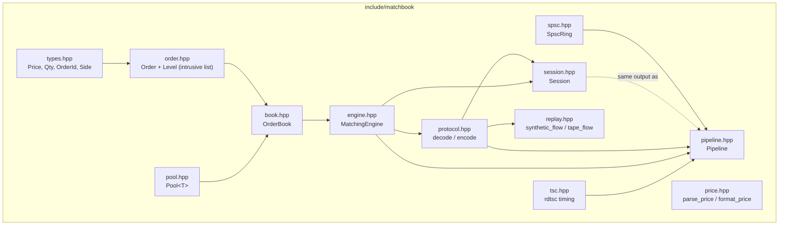
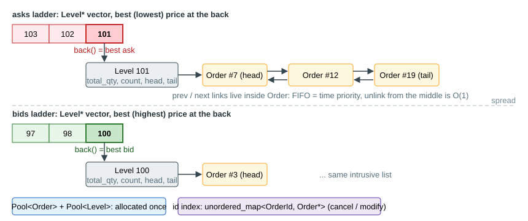
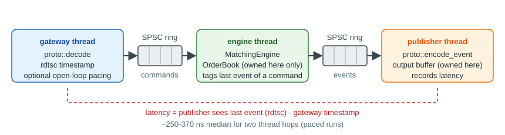

# MatchBook architecture

This document goes one level deeper than the README: how the components fit together, how
memory is laid out, what the wire format looks like byte by byte, and how the threads talk to
each other. All numbers quoted here are from the README's measurements.

- [Component overview](#component-overview)
- [Memory layout](#memory-layout)
- [Matching flow](#matching-flow)
- [Wire protocol](#wire-protocol)
- [Threading model](#threading-model)
- [Clients: replay, benchmarks, Python](#clients-replay-benchmarks-python)
- [Testing strategy](#testing-strategy)
- [Known limits](#known-limits)

## Component overview



| Component | Responsibility | Owns |
|---|---|---|
| `OrderBook` | Resting orders of one instrument; add / cancel / modify; depth queries | order pool, level pool, two ladders, id index |
| `MatchingEngine` | Price-time priority matching on top of the book; produces `Event`s | the book, a reserved event buffer |
| `proto::decode` / `encode_*` | Validate and read / write fixed-size binary messages | nothing (works on caller buffers) |
| `proto::Session` | Byte stream in, engine calls, encoded events out | engine reference, pending partial message, output buffer |
| `SpscRing` | Lock-free bounded queue between exactly two threads | its slots and counters |
| `Pipeline` | gateway / engine / publisher threads connected by two rings | the three threads for the duration of `run()` |
| `replay` | Deterministic order flow generators, trade CSV loader | nothing (returns encoded bytes) |
| `tsc.hpp` | `rdtsc` based timestamps and tick to ns conversion | nothing |

The library (`libmatchbook`) is plain C++20 with no third-party dependencies. GoogleTest,
Google Benchmark and pybind11 are only used by tests, benchmarks and the Python module.

## Memory layout



**Orders and levels** are small plain structs (`order.hpp`). An `Order` carries its own list
links, so it is simultaneously a data record and a node of its level's queue:

```text
Order  (about 56 bytes on x86-64)         Level  (about 40 bytes)
  id        u64                             price      i64
  price     i64                             total_qty  i64
  qty       i64   remaining                 count      u32
  side      u8                              head ----> oldest Order
  prev ---> Order*                          tail ----> newest Order
  next ---> Order*
  level --> Level*
```

**Pools.** `Pool<T>` allocates `capacity` slots once in a `std::vector<T>` that is never
resized, plus a vector of free pointers. `acquire()` pops a pointer, `release()` pushes it back;
neither touches the heap. Pointers stay valid for the lifetime of the pool, which is what lets
orders and levels link to each other with raw pointers. `acquire()` resets the slot with
`*p = T{}` so no state leaks between users. When the pool is empty it returns `nullptr` and the
book answers `BookFull` (or the engine rejects the order) instead of growing.

**Ladders.** Each side is a `std::vector<Level*>` sorted by price with the **best price at the
back**: bids ascending, asks descending. Consequences:

| Operation | Cost |
|---|---|
| new best level | `push_back` (amortised O(1), capacity reserved up front) |
| top level empties | `pop_back` |
| level elsewhere in the book | binary search, plus a vector insert / erase shifting the pointers behind it |
| best bid / best ask | `back()` |

Real order flow clusters near the top of the book, so the expensive path (insert in the middle)
is rare and the shifted region is a contiguous array of pointers, which is cheap compared to
chasing tree nodes.

**Id index.** `std::unordered_map<OrderId, Order*>` with capacity reserved in the constructor.
Cancel and modify look the order up here, then unlink it from its level in O(1). It is the one
piece of the book that is not a pointer-friendly array; a flat open-addressing table would be
the next optimisation if the profile asked for it.

**Priority rules** (enforced in `OrderBook::modify`): same price and smaller quantity keeps the
queue position; any price change or size increase unlinks the order and appends it to the back
of its (new) level.

## Matching flow

`MatchingEngine::submit` for one incoming order:

```text
validate qty > 0, id unique            -> Rejected(BadQuantity / DuplicateId)
FOK?  available(limit) < qty           -> Cancelled(qty)      (book untouched)
sweep(opposite side, limit, qty):
    while qty left and best opposite level is within the limit:
        fill the head of the level's FIFO, emit Trade(maker, taker, maker_price, fill)
        remove makers that are fully filled, release their pool slots
        drop the level when it empties
remaining qty:
    GTC limit    -> rest at the limit price      -> Rested(id, price, qty)
    IOC / market -> drop                         -> Cancelled(id, qty)
```

Details worth knowing:

- Trades always print at the **maker's** price.
- A market order has no limit price, so `sweep` runs until the opposite side is empty or the
  quantity is filled.
- `modify` that crosses the spread is turned into an aggressive order and goes through the same
  sweep; otherwise it stays a passive book operation.
- `events()` is a `std::vector<Event>` reserved at construction and cleared at the start of each
  call. A sweep that hits many resting orders emits one `Trade` per maker, which is why
  `BM_MarketSweep/64` costs about 27 ns per level (level walk plus trade event).
- The invariant "the book is never crossed" is checked after every message in the replay tests
  and after every chunk in the fuzzer, through `OrderBook::check_invariants()`.

## Wire protocol

Everything is fixed size and little-endian, so a decoder never scans for delimiters and every
field has a constant offset.

```text
offset  size  field
     0     2  length    whole message including the header
     2     1  type      ASCII tag
     3     1  version   1
     4     4  seq       sender's sequence number
     8     ...           body (see below)
```

| Tag | Message | Bytes | Body (offsets from message start) |
|---|---|---:|---|
| `N` | new order | 40 | id@8 u64, price@16 i64, qty@24 i64, side@32, order type@33, tif@34, 5 pad |
| `X` | cancel | 16 | id@8 |
| `M` | modify | 32 | id@8, price@16, qty@24 |
| `T` | trade | 40 | maker id@8, taker id@16, price@24, qty@32 |
| `R` | rested | 32 | id@8, price@16, qty@24 |
| `C` | cancelled | 32 | id@8, price@16, qty@24 (qty that was dropped) |
| `J` | rejected | 24 | id@8, reason@16, 7 pad |

**Decode** (`proto::decode`) returns a `DecodeResult { status, view, consumed }`:

| Status | Meaning |
|---|---|
| `Ok` | complete, valid message; `consumed` bytes can be dropped |
| `NeedMore` | the buffer ends inside a message; wait for more bytes |
| `UnknownType`, `BadLength`, `BadVersion`, `BadField` | malformed; `consumed` is 0 |

The `MessageView` is a pointer into the caller's buffer; each accessor does one unaligned
`memcpy`-style load (a single `mov` on x86). Nothing allocates or throws, and the decoder never
reads past the end of the span.

**Session framing.** `proto::Session::feed(bytes)` keeps at most one partial message in
`pending_`. A call first tops up the pending bytes, consumes complete messages straight from the
caller's buffer, and stashes the unfinished tail. Because the framing is fixed-size, the first
malformed message cannot be skipped safely, so the session stops and reports the status.
Outbound message types fed back into a session are skipped.

## Threading model



```text
gateway thread  --[ SpscRing<Command, 65536> ]-->  engine thread  --[ SpscRing<OutEvent, 65536> ]-->  publisher thread
decode, timestamp                                   match                                              encode, record latency
```

| Thread | Reads | Writes | Owns |
|---|---|---|---|
| gateway | the input stream | command ring | the read cursor |
| engine | command ring | event ring | the `MatchingEngine` and its book |
| publisher | event ring | output buffer, latency samples | the output buffer |

No locks, no shared mutable state apart from the two rings. Shutdown is a `Stop` sentinel pushed
through each ring in order, so every message sent before it is fully processed.

**`SpscRing<T, N>`**

- Capacity `N` is a power of two, the slot index is `counter & (N - 1)`.
- Counters only grow (64-bit), so full is `tail - head == N` and empty is `head == tail`; no
  slot is wasted to tell them apart.
- `tail_` is written with `release` after the slot write, read with `acquire` by the consumer;
  `head_` mirrors that. All other loads are `relaxed`. The producer is the only writer of `tail_`
  and the consumer the only writer of `head_`.
- Layout (each line is `alignas(64)`): `head_`, consumer's `tail_cache_`, `tail_`, producer's
  `head_cache_`, slots. The cached copy of the other side's counter is refreshed only when the
  ring looks full / empty, so in steady state a push or pop touches only lines its own thread
  writes.
- `Padded = false` turns padding and caching off; the benchmark shows what it is worth
  (1.2x with the CLI test, 1.6x in Google Benchmark).

**Pacing and latency.** The gateway timestamps each command with `rdtsc` right after decode.
The engine tags the last event of a command with `last = true`, and the publisher computes
`now - t_in` when it sees it. With a `rate` the gateway is **open loop**: message *i* is due at
`t_first + i / rate` regardless of how far behind the pipeline is, so the measurement is not
distorted by coordinated omission. Unpaced runs only measure queue depth and are reported as
such.

**Pinning.** `Pipeline::pin_threads({gateway, engine, publisher})` sets thread affinity (Win32
`SetThreadAffinityMask`, Linux `pthread_setaffinity_np`). Pick separate physical cores, SMT
siblings share execution units. Pinning flattens the median but cannot prevent OS preemption,
which is what the millisecond p99 / p99.9 values in the README are.

**Why the pipeline is slower than one thread.** Each message costs two cache-line transfers
(one per ring). With 30-80 ns of work per stage that handoff costs more than the parallelism
saves (7.2 vs 11.7 M msg/s). The split buys isolation, and batching the handoffs would be the
way to get throughput back.

## Clients: replay, benchmarks, Python

| Client | Entry | Goes through |
|---|---|---|
| `matchbook replay` | `tools/matchbook_cli.cpp` | `Session`, one message at a time, TSC timed |
| `matchbook bench-protocol` | same | decode only, then `Session` |
| `matchbook bench-queue` | same | raw rings, `Session`, `Pipeline` (paced / pinned) |
| Google Benchmark | `bench/bench_main.cpp` | book, engine, protocol, `Session`, ring |
| Python | `python/matchbook_py.cpp`, `python/matchbook/` | `MatchingEngine` directly (no wire format) |

**Replay.** `replay::synthetic_flow` draws event types from a merged Poisson process (60% limit,
10% marketable, 30% cancel) around a drifting mid, seeded so the same seed gives the same bytes.
`replay::tape_flow` reads `ts_ms,symbol,price,size,side` rows from `tools/export_trades.py`,
scales them to ticks and lots, quotes 5 levels per side from synthetic market makers before
each print, and sends the print as an IOC taker whose id starts at `kTakerIdBase` so its fills
can be identified in the output.

**Python.** The pybind11 module wraps `MatchingEngine`. `submit_many` takes numpy arrays,
releases the GIL while matching and returns the trades (plus counters such as `rejected`) as
numpy arrays in a dict, which is what removes the
per-call overhead (984 vs 68 ns per order). `market_order_cost` is a pure function over a book
snapshot that returns filled quantity, average price, slippage in bps and levels touched.

## Testing strategy

| Layer | Technique |
|---|---|
| Price parsing | table tests plus rejection of malformed / over-precise input |
| Book | differential test against a naive flat-map reference (200,000 random operations), invariant checks, mutation check |
| Engine | differential test against a slow re-sorting reference matcher (120,000 operations), no crossed book at any step, FOK mutation check |
| Protocol | golden bytes for `NewOrder`, 20,000 random buffers for the decoder, chunked vs whole feeding of `Session` |
| SPSC / Pipeline | two-thread stress tests, order and sum checks, torn-struct check, pipeline output byte-identical to `Session` |
| Replay | event mix within 1% of the rates, prices on the right side of the mid, CSV loader skips bad rows |
| Fuzzing | libFuzzer on `Session` with invariants checked after every chunk |
| Python | 6 pytest cases including `submit_many` equals repeated `submit` |

Counts and results (64 GoogleTest cases, 6 pytest cases, 95% line coverage, ASan / UBSan clean,
60 s fuzz run with no crashes) are in the README's *Tests and checks* section.

## Known limits

- One instrument per `OrderBook` / `MatchingEngine`; there is no symbol routing.
- Fixed capacities: orders and levels are chosen at construction (defaults 2^20 and 2^16).
- Timestamps use `rdtsc` on x86-64 and fall back to `steady_clock` elsewhere; the TSC is assumed
  to be constant-rate and synchronised across cores.
- No persistence, no network layer: the wire format is exercised through byte buffers.
- The id index is a `std::unordered_map`; a flat hash table would remove one cache miss per
  cancel.
- Microsecond-level tail latency needs isolated cores and real-time scheduling, which was not
  available on the Windows laptop used for the measurements.
